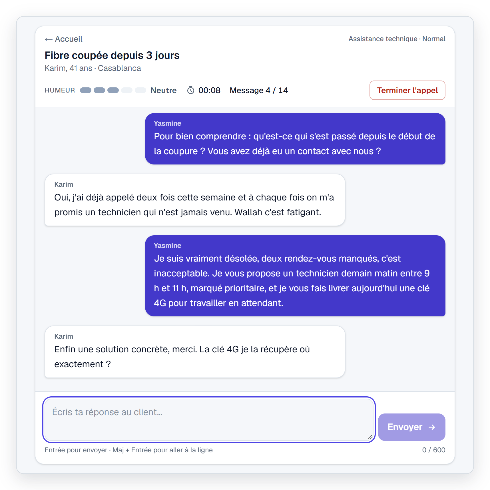
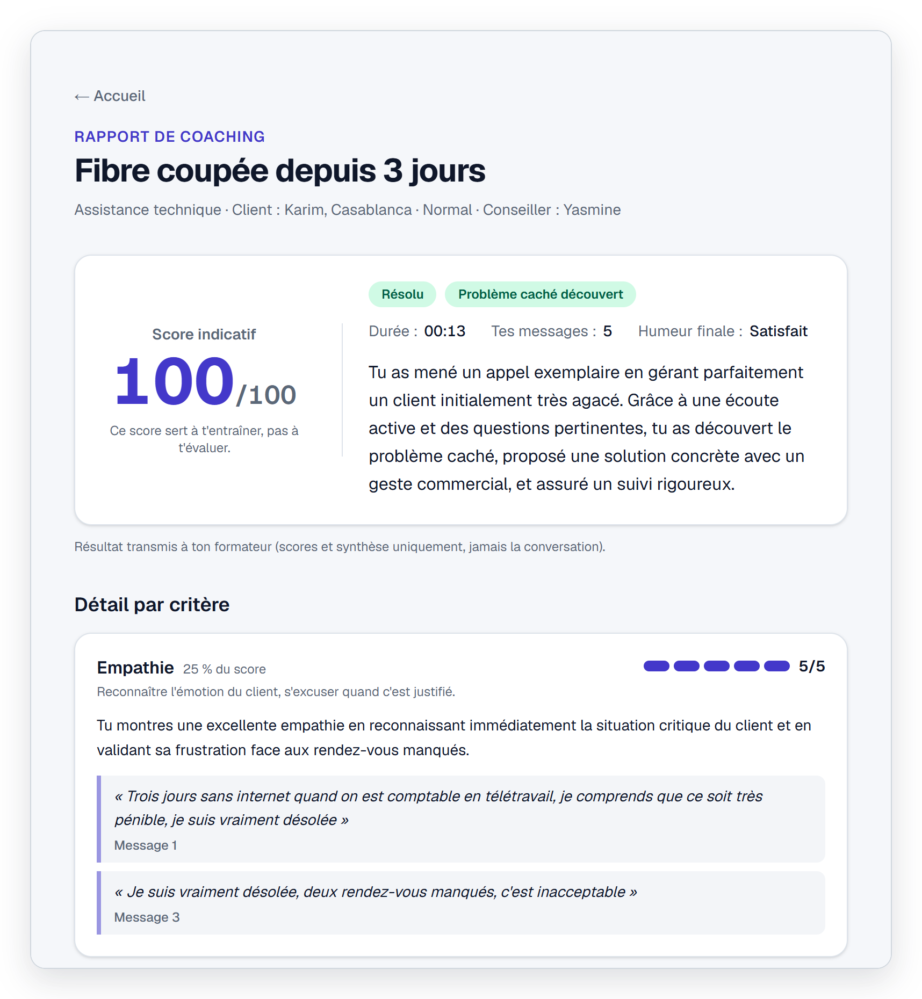
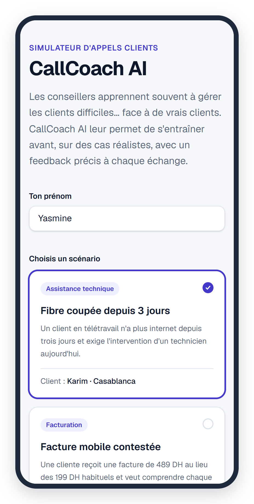
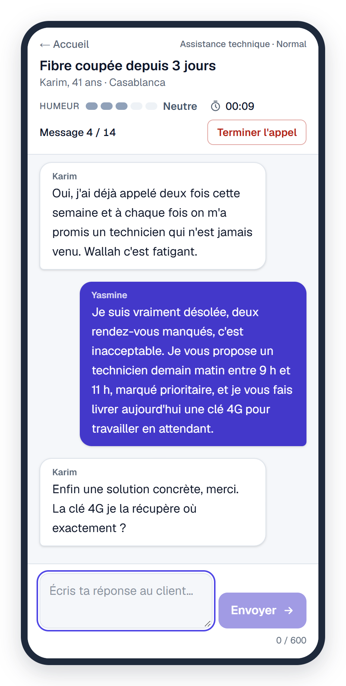
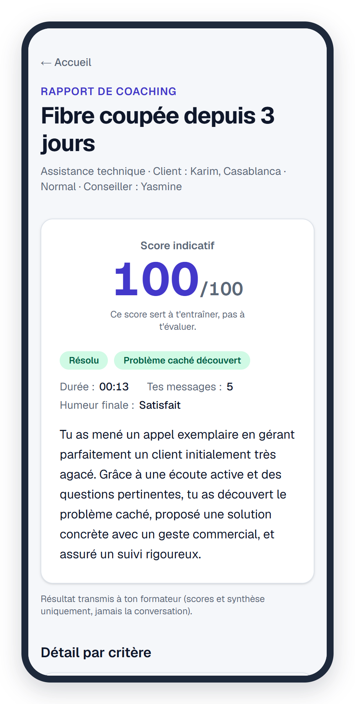

<div align="center">


# CallCoach AI

**Practise difficult customer-service calls with an AI customer,<br>then get a coaching report grounded in what you actually wrote.**

[**Try the live demo →**](https://callcoach-ai-mu.vercel.app/)

     

</div>

<br>

<p align="center">
  
</p>

## Features

- **Realistic customers.** 3 scenarios × 3 difficulty levels. Each customer has a persona, a mood that shifts after every message, and a hidden issue they only reveal when asked the right question.
- **Evidence-based coaching.** Four criteria scored 1–5, each backed by verbatim quotes from the trainee's messages, plus a rewrite of the weakest message.
- **Trainer follow-up.** Each finished call is logged to Google Sheets, and the trainer receives a weekly email summary per trainee.
- **Accessible and responsive.** Keyboard navigation, screen-reader support, mobile layout from 375 px, light and dark themes.

> The interface is in French.

## Screenshots

### Coaching report

Every quote is checked word for word against what the trainee wrote, and the overall score is computed from weighted criteria.

<p align="center">
  
</p>

### On mobile

<table>
  <tr>
    <td align="center" width="33%">
      <br>
      <b>Choose a scenario</b>
    </td>
    <td align="center" width="33%">
      <br>
      <b>Handle the call</b>
    </td>
    <td align="center" width="33%">
      <br>
      <b>Read the report</b>
    </td>
  </tr>
</table>

## How it works

- **Structured output.** Gemini returns JSON that matches a schema derived from zod, and every response is validated before use.
- **Rules in code.** Mood can change by at most one step per message. The customer hangs up after two furious replies in a row, and a call counts as resolved only once the customer is satisfied.
- **Verified quotes.** Every quote the judge cites is matched against the trainee's messages, and invented or misattributed quotes are removed.
- **Deterministic score.** The overall score is computed in code from weighted criteria, never by the model.
- **Server-side secrets.** Hidden issues and API keys never reach the browser.

More detail: [architecture and data flow](docs/architecture.md).

## Getting started

Requires Node.js 20.9+ and a [Gemini API key](https://aistudio.google.com/apikey).

```bash
git clone https://github.com/Ridadata/callcoach-ai.git
cd callcoach-ai
npm install
cp .env.example .env.local   # then add your GEMINI_API_KEY
npm run dev                  # http://localhost:3000
```

### Environment variables

| Variable | Required | Description |
| --- | :---: | --- |
| `GEMINI_API_KEY` | ✓ | Gemini API key, used server-side only |
| `GEMINI_MODEL` | | Model id, defaults to `gemini-3.5-flash-lite` |
| `APPS_SCRIPT_WEBHOOK_URL` | | Apps Script web app URL. Logging is off when empty |
| `APPS_SCRIPT_SECRET` | | Shared secret, must match the script's `SECRET` property |

### Google Sheets logging

Optional. Setup takes about 10 minutes: see [docs/apps-script.md](docs/apps-script.md).

### Deployment

The live demo runs on Vercel. To deploy your own copy, import the repository on [Vercel](https://vercel.com/new), add the environment variables, and deploy.

## Privacy and limitations

- All scenarios, personas and brands are fictional.
- The transcript stays in the browser and is only sent to Gemini to generate replies and the report. Google Sheets receives scores and a summary, never the conversation.
- On the Gemini API free tier, Google may use prompts to improve its products, so do not enter real customer data.
- Scores come from an LLM and vary between runs. They are meant for practice, not assessment.
- The demo uses the Gemini free tier and a best-effort rate limit, so it may ask you to retry when busy.
