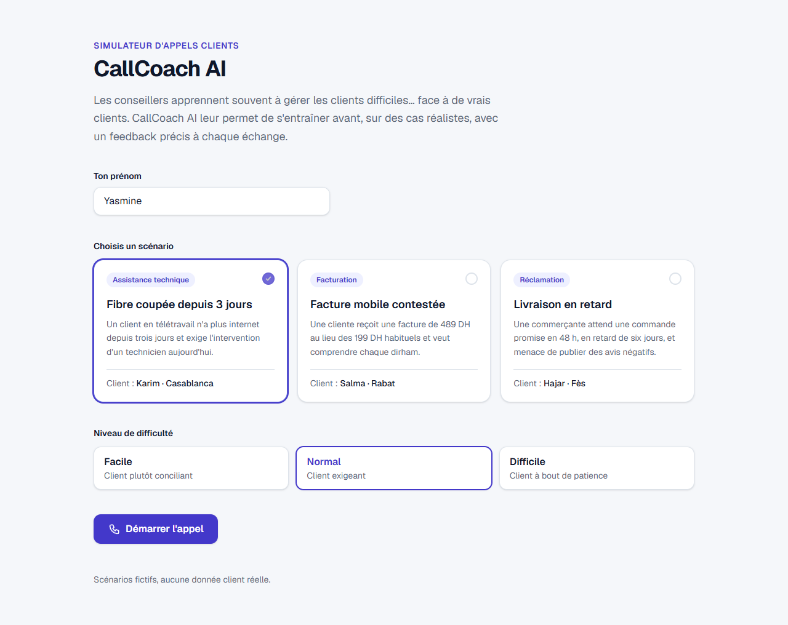
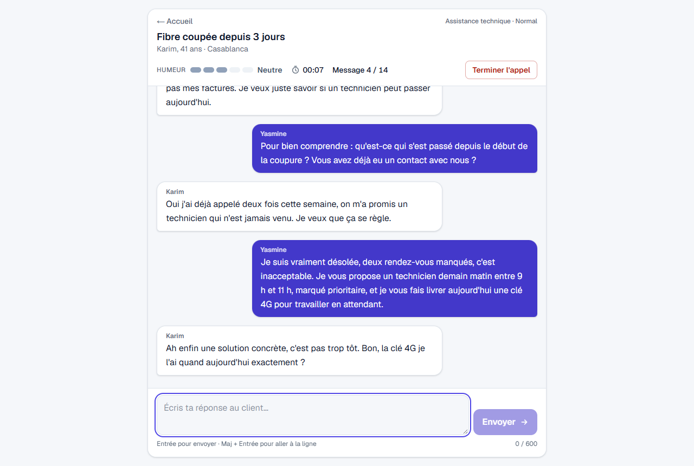
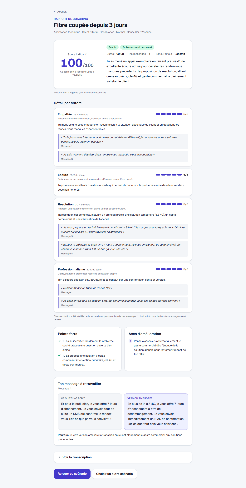
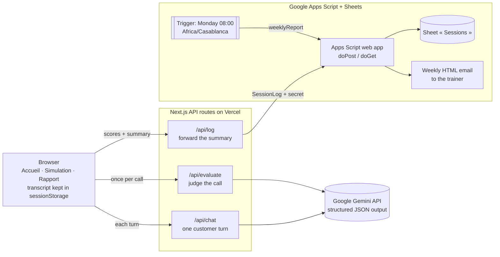

# CallCoach AI

> Les conseillers apprennent souvent à gérer les clients difficiles… face à de vrais clients. CallCoach AI leur permet de s'entraîner avant, sur des cas réalistes, avec un feedback précis à chaque échange.

A web app where customer-service trainees practise difficult calls with a virtual customer played by Google Gemini, then get an evidence-based coaching report. Results go to Google Sheets, and the trainer receives a weekly summary by email.

| Accueil | Simulation | Rapport |
| --- | --- | --- |
|  |  |  |

## Pourquoi ce projet

Les nouveaux conseillers découvrent souvent les clients difficiles en production, au détriment du client comme du conseiller. Les jeux de rôle avec un formateur sont efficaces mais rares, difficiles à planifier et peu mesurables. CallCoach AI offre un entraînement illimité sur des cas réalistes, un feedback immédiat appuyé sur les phrases du conseiller, et un suivi hebdomadaire pour le formateur.

## Features

- **3 realistic scenarios × 3 difficulty levels**, in a Moroccan context with invented brands: fibre outage (Assistance technique), disputed bill (Facturation), late delivery (Réclamation).
- **A believable virtual customer**: persona, speaking style (a few Darija words), a hidden issue revealed only to the right question, a mood that changes after every message, hang-up or satisfied ending.
- **Call interface**: live mood meter (label + colour, reason on hover), call timer, 14-message limit, in-page end confirmation, "typing" indicator, French error states with retry.
- **Coaching report**: indicative score out of 100, 4 criteria scored 1–5, each backed by **verbatim quotes checked against what the trainee typed**, hidden-issue badge, strengths, concrete improvements, a rewrite of the weakest message side by side, full transcript.
- **Trainer follow-up**: every finished call adds a row to a Google Sheet through an Apps Script web app; every Monday at 08:00 (Africa/Casablanca) the trainer gets an HTML email per trainee: sessions, average score, change vs the previous week, weakest criterion, hidden-issue discovery rate.
- **Accessible and responsive**: keyboard navigation, visible focus, screen-reader labels, colour never the only signal, `prefers-reduced-motion`, works at 375 px, light and dark mode.

## Architecture



Stack: Next.js 16 (App Router) + TypeScript (strict) + Tailwind CSS 4, [`@google/genai`](https://www.npmjs.com/package/@google/genai), zod, Google Apps Script + Google Sheets. No database, no authentication; the API key stays server-side. Details, sequence diagram and data map: [docs/architecture.md](docs/architecture.md).

## Prompt-design choices

- **Hidden issue.** Each scenario has a visible complaint and a hidden one (e.g. Karim already called twice and no technician came). The customer reveals it only when the trainee asks the kind of question listed in `revealTriggers`, which trains probing rather than scripting. Scenario files are `server-only`, so hidden issues never reach the browser bundle.
- **Mood with a ±1 clamp.** The model proposes a new mood (-2 Furieux … +2 Satisfait) after each message, with a one-sentence reason shown as a tooltip. The code clamps it to `currentMood ± 1`, so one lucky or clumsy sentence cannot swing the call. The ending rules are enforced in code too: the customer hangs up on the second reply in a row at -2, and can only end « Résolu » at +2.
- **Structured JSON output.** Both prompts use Gemini's `responseJsonSchema`, derived from the zod schemas (one source of truth) and filtered to the keywords Gemini supports. Fields are ordered so the model settles its judgement (mood reason, mood, reveal, ending; evidence before score) before writing the reply. Every output is validated with zod, retried once, then turned into a French error.
- **Verbatim-evidence check.** The judge must justify each criterion with exact quotes from the trainee's messages. `lib/evidence.ts` checks every quote against the message it cites (ignoring case, accents, whitespace and quote styles), moves a real quote cited under the wrong message to the right one, and drops anything else: invented sentences, paraphrases, the customer's words. The report always displays the trainee's exact text, and says how many quotes were removed. This is the main safeguard against an LLM judge "remembering" things the trainee never said.
- **Score computed in code.** The judge only gives 1–5 per criterion; the overall score is `round(Σ weight × (score − 1) / 4 × 100)` with weights empathie 25 %, écoute 25 %, résolution 30 %, professionnalisme 20 % (`lib/scoring.ts`). It is labelled « Score indicatif » with the note « Ce score sert à t'entraîner, pas à t'évaluer. »
- **Model settings.** Default model `gemini-3.5-flash-lite`: in playtests it answered in about 1 s with no errors, while `gemini-3.8-flash` took 3–26 s and returned 503 "high demand" errors. No temperature is sent: Gemini 3.6+ models ignore it and future models will reject it, so behaviour is steered by the prompt, the schema and the thinking level (low for the customer, medium for the judge).
- **Prompt-injection resistance.** Transcripts are sent as JSON lines, so a trainee message cannot impersonate the customer, and both prompts treat the transcript as data, not instructions.

## Local setup

Requires Node.js 20.9 or later and a Gemini API key from [Google AI Studio](https://aistudio.google.com/apikey).

```bash
npm install
cp .env.example .env.local   # then set GEMINI_API_KEY
npm run dev                  # http://localhost:3000
```

| Variable | Required | Purpose |
| --- | --- | --- |
| `GEMINI_API_KEY` | yes | Gemini API key, used server-side only |
| `GEMINI_MODEL` | no | Model id, defaults to `gemini-3.5-flash-lite` |
| `APPS_SCRIPT_WEBHOOK_URL` | no | Apps Script web app URL; logging is skipped if empty |
| `APPS_SCRIPT_SECRET` | no | Shared secret, must match the `SECRET` script property |

Other scripts: `npm run lint`, `npm run build`, `npm start`.

## Google Sheets logging and weekly report (Apps Script)

1. Create a Google Sheet (it will receive the `Sessions` tab).
2. In the Sheet: **Extensions → Apps Script**.
3. Replace the content of `Code.gs` with [`apps-script/Code.gs`](apps-script/Code.gs).
4. Recommended: **Project Settings → Show "appsscript.json" manifest file in editor**, then replace `appsscript.json` with [`apps-script/appsscript.json`](apps-script/appsscript.json) (time zone Africa/Casablanca, V8, minimal permissions).
5. **Project Settings → Script Properties**, add:
   - `SECRET`: a long random string, e.g. the output of `node -e "console.log(require('crypto').randomBytes(24).toString('hex'))"`
   - `TRAINER_EMAIL`: the address that receives the weekly report
6. In the editor, select `setup` and click **Run**, then authorise the script. Google shows an "unverified app" warning for your own scripts: **Advanced → Go to (project name)**. `setup` creates the `Sessions` tab and the Monday 08:00 trigger; running it twice does not duplicate anything.
7. **Deploy → New deployment → Web app**: execute as **Me**, who has access **Anyone**. Deploy and copy the web app URL (it ends with `/exec`).
8. Set `APPS_SCRIPT_WEBHOOK_URL` to that URL and `APPS_SCRIPT_SECRET` to the same secret, in `.env.local` and in the Vercel project settings.

Check it: opening the `/exec` URL in a browser returns `{"ok":true,"service":"callcoach-logger"}`; a finished call adds a row to `Sessions`; running `sendTestReport` emails the summary immediately. After editing `Code.gs`, publish a new version (**Deploy → Manage deployments → Edit → New version**) so the web app URL stays the same.

## Deploy to Vercel

1. Push the repository to GitHub.
2. On [vercel.com](https://vercel.com): **Add New → Project**, import the repository (Next.js is detected automatically).
3. Add the environment variables from the table above, then **Deploy**.
4. Open the URL on a phone and play a call; with Apps Script configured, check that a row appears in the Sheet.

## Limits and ethics

- **Synthetic scenarios only.** Personas and brands (Atlas Net, Oasis Mobile, Souk Express) are invented; no real customer data is used.
- **Indicative score for coaching.** The score and comments come from an LLM judge; they vary from one run to another and are meant to start a coaching conversation, not to grade people. In tests the judge separates good and poor calls clearly but is harsh at the low end (a curt but polite agent can score close to 0).
- **No transcript stored server-side.** The transcript lives in the browser (`sessionStorage`), is sent to `/api/chat` each turn and to `/api/evaluate` once to be processed by Gemini, and is never logged by the app. Google Sheets receives only scores, outcome, summary and the trainee's first name, and the report tells the trainee when their result has been sent to the trainer.
- **Gemini API terms.** On the Gemini API free tier, Google uses prompts and responses to improve its products and human reviewers may read them ([terms](https://ai.google.dev/gemini-api/terms)). That is acceptable for synthetic scenarios and trainee practice text; use a paid tier before any real customer data is involved.
- **Demo-grade protection.** The rate limit (30 chats, 5 evaluations, 10 logs per IP per 10 minutes) lives in memory and is best-effort on serverless. `/api/log` validates rows and checks score consistency, but is not authenticated; a production version would add trainee accounts or signed results.

## Roadmap / v2

1. **Judge consistency check** (`scripts/judge-consistency.ts`): run the judge several times on saved transcripts and report per-criterion standard deviation and the share of identical scores.
2. **Trainee history page** from past sessions stored locally in the browser.
3. **Scenario editor** for trainers (JSON form) so they can add scenarios without code.
4. **Voice mode**: speech-to-text for the trainee and text-to-speech for the customer.
