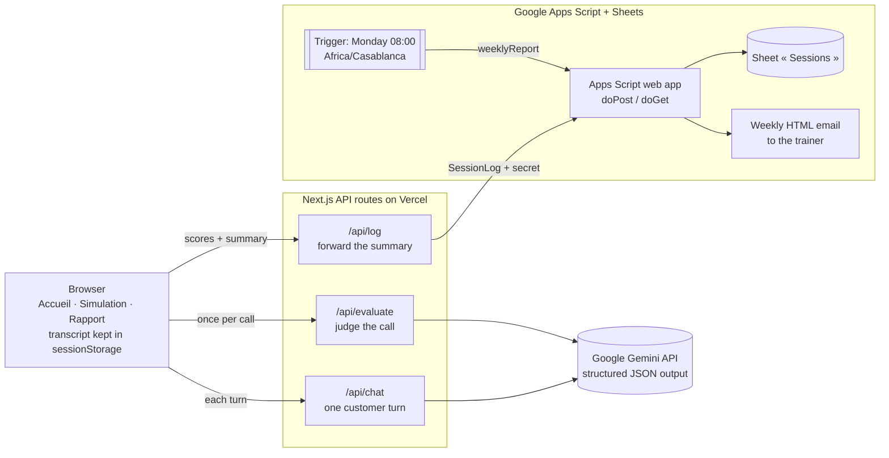
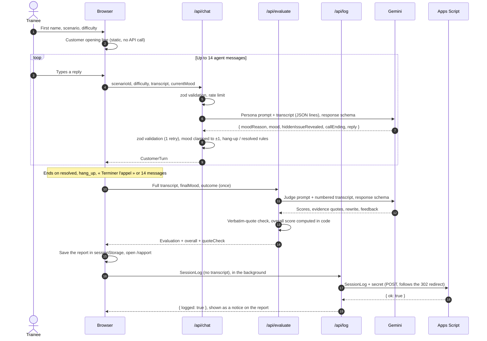

# Architecture

CallCoach AI is a single Next.js app (App Router) deployed on Vercel. Its API routes are the only backend: they call Google Gemini and forward session summaries to a Google Apps Script web app, which writes them to a Google Sheet and emails a weekly report to the trainer. There is no database and no authentication.

## Overview



## One call, step by step



## Where data lives

| Data | Where | Lifetime |
| --- | --- | --- |
| Transcript of the call | Browser memory + `sessionStorage` | Until the tab is closed |
| Transcript sent for processing | `/api/chat` (each turn), `/api/evaluate` (once), then Gemini | Not stored by the app |
| Evaluation and report | Browser `sessionStorage` | Until the tab is closed |
| Session summary (scores, outcome, summary, first name) | Google Sheet « Sessions » | Kept by the trainer |
| Hidden issues, reveal triggers, ideal resolutions | Server only (`lib/scenarios.ts` is `server-only`) | Never sent to the browser |
| Gemini API key, Apps Script secret | Server environment variables | Never sent to the browser |

## Reliability and safety measures

| Concern | Measure | Code |
| --- | --- | --- |
| Malformed or malicious requests | Every API input is validated with zod (role alternation, 600-character agent messages, max 30 messages, mood consistency) | `lib/schemas.ts`, `lib/apiRequest.ts` |
| Model output drift | Structured JSON output from a schema derived from zod; zod validation, one retry, then a French 502 | `lib/gemini.ts` |
| Mood jumping | Mood clamped to `currentMood ± 1` in code | `lib/customerTurn.ts` |
| Inconsistent endings | Hang-up forced on the 2nd reply in a row at -2 (opening line excluded) and refused otherwise; « resolved » only at +2 | `lib/customerTurn.ts` |
| Invented evidence | Every quote must be found verbatim in the trainee's messages; the report shows the trainee's exact text | `lib/evidence.ts` |
| Model doing arithmetic | Overall score computed in code from the four criteria | `lib/scoring.ts` |
| Prompt injection | Transcript sent as JSON lines; customer and judge prompts say the transcript is data | `lib/prompts.ts` |
| Quota abuse | In-memory rate limit per IP: 30 chats, 5 evaluations, 10 logs per 10 minutes (best-effort on serverless) | `lib/rateLimit.ts` |
| Spreadsheet formula injection | Text starting with `= + - @` is stored as plain text | `apps-script/Code.gs` |
| Duplicate log rows | Apps Script skips a `sessionId` already in the sheet | `apps-script/Code.gs` |

## Project structure

```
app/
  page.tsx                       Accueil (server component, renders StartForm)
  simulation/[scenarioId]/page.tsx  Simulation (difficulty from the query string)
  rapport/page.tsx               Rapport (reads sessionStorage)
  api/chat · api/evaluate · api/log
components/                      Client UI (SimulationView, ChatWindow, MoodMeter, ReportView, …)
lib/
  apiRequest.ts    JSON body parsing and error responses for the API routes
  gemini.ts        SDK client, structured-output helper, zod → Gemini schema
  scenarios.ts     The three scenarios (server-only)
  prompts.ts       Customer and judge prompts
  schemas.ts       zod schemas and shared types
  customerTurn.ts  Mood clamp and call-ending rules
  callSession.ts   Client reducer for one call
  evidence.ts      Verbatim-quote check
  scoring.ts       Overall score
  rateLimit.ts     In-memory rate limiter
  reportStorage.ts · trainee.ts · sessionLog.ts   Browser storage and the Sheets row
apps-script/       Code.gs + appsscript.json (Google Sheets logger and weekly report)
```
